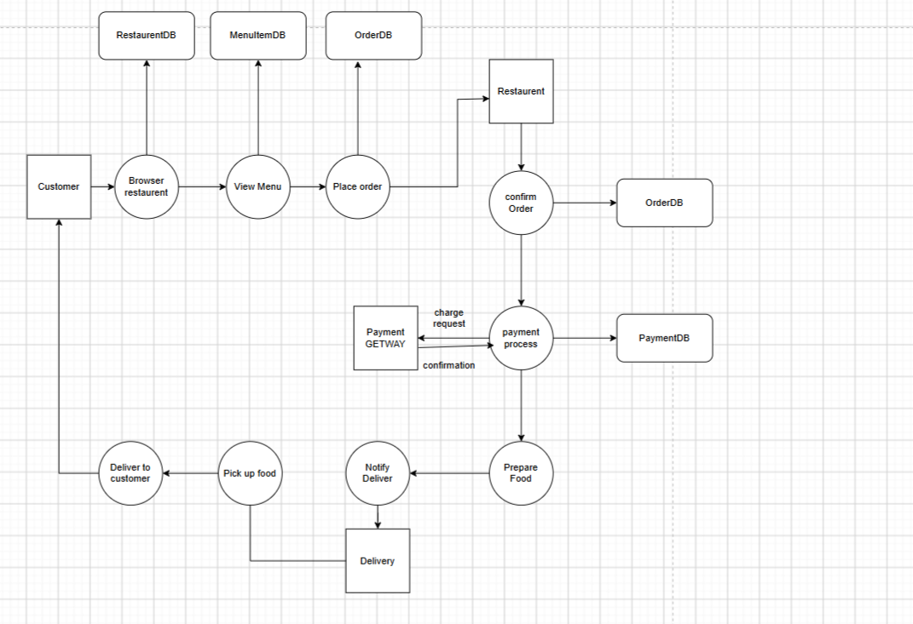

# Food Delivery Application with Golang (High Performance)


A production-oriented food delivery platform designed to connect customers, restaurant owners, delivery drivers, and system administrators.

The application allows customers to discover restaurants, browse menus, place orders, make payments, and track deliveries. Restaurant owners can manage their restaurants, menus, and orders, while delivery drivers can manage assigned deliveries and update order statuses.


---

## Table of Contents

* [Overview](#overview)
* [Core Features](#core-features)
* [System Workflow](#system-workflow)
* [Data flow](#data-flow)
* [Functional Requirements](#functional-requirements)
* [Non-Functional Requirements](#non-functional-requirements)
* [Technology Stack](#technology-stack)
* [System Architecture](#system-architecture)
* [Database Design](#database-design)
* [Database Relationships](#database-relationships)
* [Order Lifecycle](#order-lifecycle)
* [Transactions and Data Consistency](#transactions-and-data-consistency)


---

# Overview

The Food Delivery Application is a multi-role platform composed of four main actors:

* Customer
* Restaurant Owner
* Delivery Driver
* System Administrator

The system is designed around the complete food ordering lifecycle:

```text
Restaurant Discovery
        |
        v
Menu Selection
        |
        v
Cart
        |
        v
Order Creation
        |
        v
Payment
        |
        v
Restaurant Processing
        |
        v
Driver Assignment
        |
        v
Food Pickup
        |
        v
Food Delivery
        |
        v
Order Completion
```

The project focuses on production-oriented backend engineering concepts such as database transactions, concurrency, caching, authentication, authorization, payment processing, scalability, and deployment.

---

# Primary System Design 


# Core Features

## Customer

Customers can:

* Register and authenticate
* Verify their email address
* Reset their password
* Manage their profile
* Browse restaurants
* Search restaurants
* Filter restaurants
* View restaurant menus
* Search menu items
* Filter menu items
* Add items to the cart
* Update cart quantities
* Remove items from the cart
* Place orders
* Select a payment method
* Pay using Stripe
* Pay using PayPal
* Pay using Cash on Delivery
* Receive order status notifications
* Track order progress

---

## Restaurant Owner

Restaurant owners can:

* Register and authenticate
* Verify their email address
* Reset their password
* Manage their profile
* Create multiple restaurants
* Update restaurants
* Delete restaurants
* Manage restaurant information
* Create categories
* Update categories
* Delete categories
* Create menu items
* Update menu items
* Delete menu items
* Manage menu item availability
* Manage stock
* Receive incoming orders
* Accept orders
* Reject orders
* Update order progress
* Notify customers
* Assign orders to available delivery drivers

---

## System Administrator

Administrators can:

* Manage customers
* Manage restaurant owners
* Manage restaurants
* Manage delivery drivers
* Manage orders
* Manage payments
* Monitor the overall platform
* Manage system-level resources and operations

---

## Delivery Driver

Delivery drivers can:

* Register and authenticate
* Verify their email address
* Reset their password
* Manage their profile
* Set their availability status
* Become active or inactive
* Receive delivery assignments
* Accept delivery assignments
* View restaurant pickup information
* View customer delivery information
* Update delivery status
* Confirm completed deliveries
* Handle Cash on Delivery orders

---

# System Workflow

The primary order workflow is:

```text
Customer
   |
   v
Register / Login
   |
   v
Browse Restaurants
   |
   v
Select Restaurant
   |
   v
Browse Menu
   |
   v
Add Items to Cart
   |
   v
Place Order
   |
   +-----------------------+
   |                       |
   v                       v
Online Payment        Cash on Delivery
   |                       |
   +-----------+-----------+
               |
               v
       Restaurant Receives Order
               |
               v
        Accept / Reject Order
               |
               v
         Prepare the Order
               |
               v
       Assign Available Driver
               |
               v
          Driver Accepts
               |
               v
           Food Pickup
               |
               v
          Food Delivery
               |
               v
        Order Completed
```

---

# Data flow


 
# Functional Requirements

## Customer

| Requirement          | Description                         |
| -------------------- | ----------------------------------- |
| Authentication       | Registration, login and logout      |
| Email Verification   | Verify customer email               |
| Password Reset       | Reset forgotten passwords           |
| Restaurant Discovery | Browse restaurants                  |
| Restaurant Search    | Search restaurants                  |
| Restaurant Filtering | Filter restaurants                  |
| Menu                 | Browse restaurant menu              |
| Menu Search          | Search menu items                   |
| Menu Filtering       | Filter menu items                   |
| Cart                 | Add, update and remove items        |
| Orders               | Create and track orders             |
| Payments             | Stripe, PayPal and Cash on Delivery |
| Notifications        | Receive order updates               |

---

## Restaurant Owner

| Requirement           | Description                                 |
| --------------------- | ------------------------------------------- |
| Authentication        | Registration and login                      |
| Restaurant Management | Create, read, update and delete restaurants |
| Category Management   | Create, read, update and delete categories  |
| Menu Management       | Create, read, update and delete menu items  |
| Stock Management      | Manage menu item stock                      |
| Availability          | Enable or disable menu items                |
| Order Management      | Accept, reject and process orders           |
| Notifications         | Notify customers and drivers                |
| Driver Assignment     | Assign orders to available drivers          |

---

## System Administrator

| Requirement           | Description               |
| --------------------- | ------------------------- |
| User Management       | Manage all platform users |
| Restaurant Management | Manage all restaurants    |
| Order Management      | Manage all orders         |
| Payment Management    | Manage payment records    |

---

## Delivery Driver

| Requirement       | Description                    |
| ----------------- | ------------------------------ |
| Authentication    | Registration and login         |
| Availability      | Active/inactive status         |
| Assignment        | Receive delivery assignments   |
| Pickup            | View restaurant pickup address |
| Delivery          | View customer delivery address |
| Status Management | Update delivery status         |
| Payment           | Handle Cash on Delivery        |

---

# Non-Functional Requirements

## Availability

The system should be available 24/7 with minimal downtime.

## Security

Authentication, authorization, payment processing, and sensitive data must be protected against common security threats.

## Consistency

Critical operations must maintain data consistency, especially:

* Orders
* Order items
* Stock
* Payments
* Deliveries

## Scalability

The architecture should support increasing numbers of:

* Customers
* Restaurants
* Menu items
* Orders
* Drivers
* Concurrent requests

## Maintainability

The system should follow clear architectural boundaries and maintain a modular, testable, and understandable codebase.

## Performance

The system should minimize latency through:

* Database indexing
* Query optimization
* Redis caching
* Connection pooling
* Efficient API design
* Nginx
* Horizontal scaling when required

---

# Technology Stack

| Layer            | Technology       |
| ---------------- | ---------------- |
| Frontend         | Next.js          |
| Language         | TypeScript       |
| Backend          | Go               |
| Database         | PostgreSQL       |
| Cache            | Redis            |
| Reverse Proxy    | Nginx            |
| Containerization | Docker           |
| CI/CD            | GitHub Actions   |
| Cloud Provider   | DigitalOcean     |
| Online Payments  | Stripe, PayPal   |
| Offline Payments | Cash on Delivery |

---

# System Architecture

The initial architecture follows a modular backend approach.

```text
                         Client
                           |
                           v
                    +--------------+
                    |   Next.js    |
                    |  TypeScript  |
                    +------+-------+
                           |
                           v
                    +--------------+
                    |    Nginx     |
                    | Reverse Proxy|
                    +------+-------+
                           |
                           v
                    +--------------+
                    |   Go API     |
                    |   Backend    |
                    +------+-------+
                           |
             +-------------+-------------+
             |                           |
             v                           v
      +--------------+             +--------------+
      |  PostgreSQL  |             |    Redis     |
      |   Database   |             |    Cache     |
      +--------------+             +--------------+
             |
             v
      +--------------+
      |   Payment    |
      |  Providers   |
      +--------------+
```

The backend is responsible for enforcing business rules, validating requests, managing transactions, and communicating with external payment providers.

---

# Database Design
 

---

# Order Lifecycle

An order moves through several states.

```text
PENDING
   |
   +----> REJECTED
   |
   v
ACCEPTED
   |
   v
PREPARING
   |
   v
READY
   |
   v
ASSIGNED
   |
   v
PICKED_UP
   |
   v
DELIVERED
```

An order may also be cancelled depending on the business rules.

---

# Transactions and Data Consistency

Order creation is a critical operation and should be handled inside a PostgreSQL transaction.

A simplified flow:

```text
BEGIN TRANSACTION

1. Validate cart
2. Validate menu items
3. Validate stock
4. Create order
5. Create order items
6. Decrease stock
7. Create payment record
8. Clear cart

COMMIT
```

If any operation fails:

```text
ROLLBACK
```

Example:

```text
BEGIN
   |
   +-- Create Order
   |
   +-- Create Order Items
   |
   +-- Update Stock
   |
   +-- Create Payment
   |
   +-- COMMIT
```

If stock validation fails:

```text
BEGIN
   |
   +-- Create Order
   |
   +-- Create Order Items
   |
   +-- Update Stock ---- FAILED
   |
   +-- ROLLBACK
```

This prevents the database from entering an inconsistent state.

---

# Concurrency and Stock Management

Stock management introduces a concurrency problem.

For example, if only one item remains:

```text
Stock = 1
```

Two customers may attempt to purchase it simultaneously.

The backend must prevent both transactions from successfully purchasing the same item.

PostgreSQL row-level locking can be used for critical stock operations.

Conceptually:

```text
BEGIN

SELECT stock
FROM menu_items
WHERE id = ?
FOR UPDATE;

Validate stock

UPDATE menu_items
SET stock = stock - quantity
WHERE id = ?;

COMMIT
```

This ensures that concurrent transactions cannot incorrectly consume the same stock.
